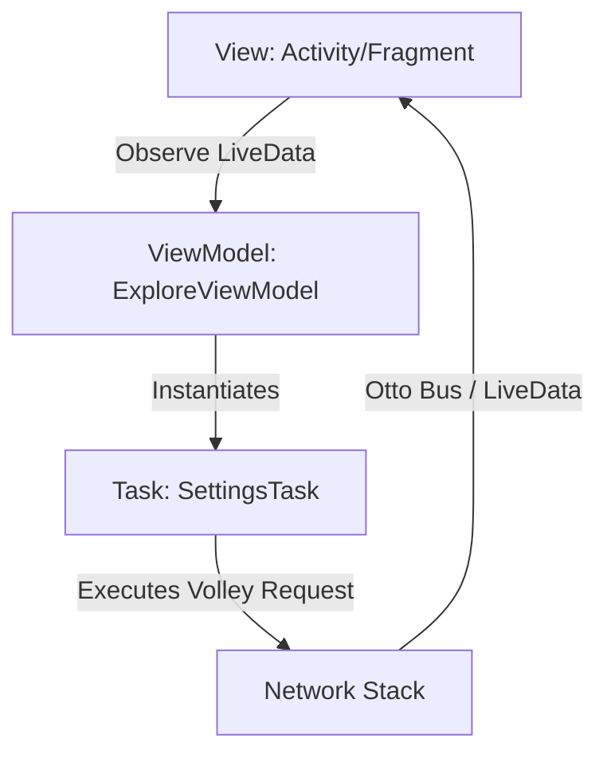

# EazyDiner Android Project: Senior/Tech Lead/FAANG Interview Prep Guide

This guide compiles a deep-dive architectural analysis and interview preparation playbook based on the source code of the EazyDiner Android project. It is structured to help you demonstrate tech leadership, system design expertise, and deep Android fundamentals during interviews at top-tier product companies (FAANG).

---

## 1. Project Overview

### Application Purpose
EazyDiner is a restaurant table reservation, dining discount, and digital payment application (PayEazy). It allows users to discover restaurants, view details and reviews, purchase prime memberships, book tables, and pay bills with integrated banking promotions and payment gateways.

### Architecture
The project employs a variation of **MVVM (Model-View-ViewModel)** and **Component-Driven design**, characterized by:
*   **Custom Task Pattern**: Background API requests are structured as custom objects (e.g., `AppVersionTask`, `SettingsTask`) extending `BlockRepetitionTask` or implementing Volley's request listeners directly.
*   **Event-Driven Communication**: Communication between asynchronous background tasks, workers, and UI components is largely orchestrated via the deprecated **Otto Event Bus** (`BusProvider`).
*   **Data Flow**:
    1. Activities/Fragments trigger `Tasks` or delegate actions to ViewModels.
    2. ViewModels instantiate task instances that communicate via `MutableLiveData` or dispatch events to the Otto Event Bus.
    3. The UI components observe LiveData or subscribe to Otto events to redraw themselves.

### Folder/Module Structure
The project is split into the following submodules:
1.  **`:app`**: Contains the core logic, activities, fragments, ViewModels, database, and UI logic for EazyDiner.
2.  **`:barcode`**: Module handling barcode scanning logic.
3.  **`:countryselector`**: Helper module for country code selection and telephone number routing.
4.  **`:PushTemplates`**: Configures custom push notification rendering layout templates (WebEngage integration).

### Third-Party Libraries & Rationale
*   **Volley** (`com.android.volley:volley`): Handles network request queues and HTTP caching.
*   **Otto Event Bus** (`com.squareup:otto`): Event bus for posting and subscribing to background notifications (e.g., login status, payment status, task completion).
*   **Room Database** (`androidx.room`): Local offline caching for searches, location searches, contact lists, and bottom sheet configurations.
*   **WorkManager** (`androidx.work`): Performs background scheduling for intensive tasks such as contacts retrieval and image/bill uploading.
*   **Glide** (`com.github.bumptech.glide`): Image downloading and disk caching (including Compose integration).
*   **Branch SDK** (`io.branch.sdk.android`): Attributing installs, handling deep links, and managing referral programs.
*   **WebEngage SDK** (`com.webengage:android-sdk`): Marketing campaigns, custom push notification templates, and in-app targeting.
*   **Microsoft Clarity SDK** (`com.microsoft.clarity`): Session replay, heatmaps, and user path tracking.
*   **Juspay HyperSDK** (`in.juspay:hypersdk`): In-app payment processing and unified checkout experience.
*   **Lottie** (`com.airbnb.android:lottie`): Playing vector-based rich JSON animations.
*   **ExoPlayer** (`com.google.android.exoplayer`): Custom inline video player integration.

---

## 2. Technology Stack

*   **Kotlin & Java**: A hybrid codebase (e.g., legacy files like [EazyDiner.java](file:///Users/eazydiner/Desktop/ED/EazyDiner/app/src/main/java/com/appstreet/eazydiner/EazyDiner.java) and [BaseActivity.java](file:///Users/eazydiner/Desktop/ED/EazyDiner/app/src/main/java/com/appstreet/eazydiner/activity/BaseActivity.java) are written in Java; modern ViewModels, Compose files, and Workers are written in Kotlin).
*   **Jetpack Suite**:
    *   **Compose**: Jetpack Compose (`compose-bom:2025.09.00`) is integrated for rendering custom UI elements (e.g., scalloped shapes, custom date fields).
    *   **Room**: Manages local SQLite storage with custom type converters ([DateConverter.java](file:///Users/eazydiner/Desktop/ED/EazyDiner/app/src/main/java/com/appstreet/eazydiner/database/DateConverter.java)) and database migration logic.
    *   **WorkManager**: Guarantees execution of contact syncing ([RetrieveContactsWorker.kt](file:///Users/eazydiner/Desktop/ED/EazyDiner/app/src/main/java/com/appstreet/eazydiner/referAndEarn/referFriends/task/RetrieveContactsWorker.kt)) and multipart image uploads ([ImageUploadWorker.kt](file:///Users/eazydiner/Desktop/ED/EazyDiner/app/src/main/java/com/appstreet/eazydiner/service/ImageUploadWorker.kt)).
    *   **LiveData**: Exposes asynchronous network states and UI configurations from ViewModels.
*   **Networking & Concurrency**:
    *   Volley combined with a custom HTTP stack ([OwnHttpClientStack.java](file:///Users/eazydiner/Desktop/ED/EazyDiner/app/src/main/java/com/appstreet/eazydiner/network/OwnHttpClientStack.java)) that wraps the legacy `AndroidHttpClient` and Apache HTTP library.
    *   Custom Java threads and fixed thread pools (`Executors.newFixedThreadPool(3)`) via [AppExecuters.java](file:///Users/eazydiner/Desktop/ED/EazyDiner/app/src/main/java/com/appstreet/eazydiner/database/AppExecuters.java).
*   **Gradle Configurations**: Multi-variant setup supporting `debug`, `qaRelease`, and `release` with dynamic variables such as `FB_APP_ID`, `BRANCH_KEY`, and custom endpoint URLs (`SERVER`, `SERVER_NEW`).
*   **Testing Gaps**: Complete lack of JUnit unit tests and Espresso UI tests. No test directory exists under `app/src`.

---

## 3. Feature- & Component-Level Interview Questions

### Beginner Level
1.  **Concept**: Why does this project use multiple modules like `:barcode` and `:countryselector`?
    *   *Answer*: To break code into logically distinct libraries, decreasing compile times (via incremental builds) and enabling code reusability.
2.  **Scenario**: In `EazyDiner.java`, why is `MultiDex.install(this)` called inside `attachBaseContext`?
    *   *Answer*: The app imports many libraries, pushing the method count past the 65,536 limit (DEX limit). MultiDex splits the classes into multiple `.dex` files.

### Intermediate Level
3.  **Optimization**: Volley has an `LruBitmapCache`. What is the purpose of LRU, and how does it prevent OutOfMemory (OOM) errors when downloading images?
    *   *Answer*: Least Recently Used cache discards the oldest accessed bitmaps when memory limits are reached, maintaining a low memory footprint.
4.  **Debugging**: How would you debug an issue where an event posted via `BusProvider.instance.post()` is never received by a subscriber?
    *   *Answer*: Check if the target subscriber called `BusProvider.instance.register(this)` in its lifecycle (e.g., `onStart()` or `onCreate()`), and ensure the subscription method is annotated with `@Subscribe` and takes the exact matching event class parameter.

### Senior Level
5.  **Architecture**: What are the trade-offs of using reflection-based instantiation in `EzViewModelProvider` to inject bundles into ViewModels?
    *   *Answer*: It simplifies bundle injection without boilerplate, but reflection introduces runtime overhead, bypasses compile-time type-safety checks, and breaks DI tools like Hilt or Dagger ViewModel factories.
6.  **System Design**: EazyDiner blocks repeated API calls via `BlockRepetitionTask`. How does this work under the hood, and what are its limitations?
    *   *Answer*: It checks a saved timestamp in `SharedPref` for a specific task key. If the difference is less than the interval (30 mins), the call is skipped. Limitations include lack of cache invalidation if underlying data changes, and it relies on volatile client-side system clocks.

### Staff/Architect Level
7.  **Architectural Critique**: Explain the hazards of relying on the Otto Event Bus for networking callbacks rather than Kotlin Flows or LiveData.
    *   *Answer*: Otto Event Bus broadcasts globally. It causes loose coupling but leads to hard-to-trace data flows (spaghetti communication), lacks scoping (events can trigger in background components), doesn't respect component lifecycles (raising memory leak risks if unregistration fails), and lacks support for backpressure or thread dispatching.
8.  **Design Decoupling**: If you were to migrate this project to Hilt and Retrofit, what steps would you take to preserve the existing module structure?
    *   *Answer*: Introduce a `@Module` in the Core/App module, replace `OwnHttpClientStack` with an OkHttpClient configuration, convert custom `Task` classes to repository functions returning Flow/Coroutines, and annotate ViewModels with `@HiltViewModel` for constructor injection.

---

## 4. Deep-Dive Code Walkthroughs

### [EazyDiner.java](file:///Users/eazydiner/Desktop/ED/EazyDiner/app/src/main/java/com/appstreet/eazydiner/EazyDiner.java)
*   **Responsibility**: The custom `Application` class. Configures global states, sets up WebEngage lifecycle callbacks, registers Google/Firebase Analytics, and runs background initializations (Clarity, location service, remote config).
*   **Design Pattern**: Singleton provider (`getContext()`).
*   **Code Smell**: Thread-blocking `SharedPref` checks and direct instantiation of network stacks on the main thread during `onCreate()`.
*   **Edge Case / Crash Risk**: If Google Play Services is outdated, `FirebaseMessaging.getInstance().getToken()` or analytic setups might throw a `PlayServicesNotAvailableException` or `ConcurrentModificationException` (lines 224-228), which is caught globally but shows critical instability.

### [BaseActivity.java](file:///Users/eazydiner/Desktop/ED/EazyDiner/app/src/main/java/com/appstreet/eazydiner/activity/BaseActivity.java)
*   **Responsibility**: Base class managing custom fragment animations, Chrome Custom Tabs utilities, file sharing setups (Glide + FileProvider), and app lifecycle counts to detect when the app returns from background.
*   **Design Pattern**: Template Method pattern (abstract methods like `findView()`, `initView()`, `bindView()`).
*   **Code Smell**: Heavy activity-routing overhead; fragment-handling logic contains hardcoded references to specific fragments like `NewRestaurantDetailFragment` and `LeaderBoardPagerFragment`, breaking the Open/Closed Principle.
*   **Edge Case / Crash Risk**: Inside `shareImageAndText` (lines 523-586), file writing is executed on a single-thread executor. If the activity is destroyed before the run finishes, writing to `getCacheDir()` and updating the UI on `runOnUiThread()` can cause memory leaks or `IllegalStateException: Activity is destroyed`.

### [MainActivity.java](file:///Users/eazydiner/Desktop/ED/EazyDiner/app/src/main/java/com/appstreet/eazydiner/activity/MainActivity.java)
*   **Responsibility**: Home activity hosting the primary ViewPager, dealing with location updates, deep-link routing, and Juspay checkout initialization.
*   **Design Pattern**: Observer pattern (observes LiveData and implements Otto subscriber annotations).
*   **Code Smell**: A monolithic class (over 1,200 lines) with high coupling. It mixes UI logic, location validation, deep link parsing, shortcuts management, and Play Store update flows.
*   **Edge Case / Crash Risk**: `mViewPager.setCurrentItem(position)` is posted asynchronously. If user rotates the screen quickly, `mViewPager` might be null, causing a crash.

### [ExploreViewModel.kt](file:///Users/eazydiner/Desktop/ED/EazyDiner/app/src/main/java/com/appstreet/eazydiner/viewmodel/ExploreViewModel.kt)
*   **Responsibility**: The ViewModel for the main search/explore screen. It merges local cache entities (bookings, cashbacks, reviews) into a list of carousel items (`mapToCarouselItems`) and sorts restaurant hubs by distance.
*   **Design Pattern**: MVVM State Container.
*   **Code Smell**: Excessive mutable states and tightly coupled logic for filtering dates/times (`checkConditionForNextDayVisibility`).
*   **Edge Case / Crash Risk**: Distance calculations (`getDistance`, lines 318-342) read directly from global `SharedPref` properties. If location values are set concurrently or return null/0.0, parsing can fail or throw `NullPointerException` if Kotlin's nullability is bypassed.

### [RetrieveContactsWorker.kt](file:///Users/eazydiner/Desktop/ED/EazyDiner/app/src/main/java/com/appstreet/eazydiner/referAndEarn/referFriends/task/RetrieveContactsWorker.kt)
*   **Responsibility**: Background WorkManager task to read contact listings via ContentResolver, clear old entries in Room, and insert new contacts.
*   **Design Pattern**: Strategy pattern (Workers).
*   **Code Smell**: Instantiates `AppExecuters` directly in `doWork()` (`AppExecuters()`) rather than using DI, and runs a global DB wipe on every execution.
*   **Edge Case / Crash Risk**: If database operations throw an SQLite write lock exception due to concurrent writes, it crashes or returns `Result.failure()`.

### [ImageUploadWorker.kt](file:///Users/eazydiner/Desktop/ED/EazyDiner/app/src/main/java/com/appstreet/eazydiner/service/ImageUploadWorker.kt)
*   **Responsibility**: A background Worker to compress images and upload them using `HttpURLConnection` multipart/form-data.
*   **Design Pattern**: Worker delegation.
*   **Code Smell**: Manual construction of HTTP multipart payloads (writing boundaries, content headers, byte buffers by hand).
*   **Edge Case / Crash Risk**: Memory pressure inside `compress` (lines 259-281). If large images are decoded, the loops allocating `ByteArrayOutputStream` can trigger an OutOfMemoryError.

### [OwnHttpClientStack.java](file:///Users/eazydiner/Desktop/ED/EazyDiner/app/src/main/java/com/appstreet/eazydiner/network/OwnHttpClientStack.java)
*   **Responsibility**: Custom Volley HTTP stack that maps requests to legacy Apache HTTP calls.
*   **Design Pattern**: Adapter pattern.
*   **Code Smell**: Relies entirely on the deprecated Apache HTTP client and `legacy-support-v4` libraries.
*   **Edge Case / Crash Risk**: Connection timeouts are hardcoded to 5000ms. If network switching occurs (LTE to Wifi), request sockets can hang or crash due to legacy stack failures on modern Android OS versions.

### [AppDatabase.java](file:///Users/eazydiner/Desktop/ED/EazyDiner/app/src/main/java/com/appstreet/eazydiner/database/AppDatabase.java)
*   **Responsibility**: Room database definition hosting multiple search and contact entities, defining database migrations.
*   **Design Pattern**: Singleton.
*   **Code Smell**: The infamous `addDelay()` (lines 170-175) that sleeps the background thread for 4 seconds during database creation.
*   **Edge Case / Crash Risk**: If migrations fail or are missing indices (e.g., version 8 to 9, line 126), Room throws an `IllegalStateException` saying that the database schema does not match the compiled version.

---

## 5. Android Fundamentals

### Activity & Fragment Lifecycles
*   **Process Death**: In `BaseActivity.java`, the `mTransactionId` is stored in the bundle during `onSaveInstanceState(Bundle outState)` (line 101) and restored during `onCreate`. This allows tracking state changes across system process deaths.
*   **Configuration Changes**: Since `MainActivity` depends heavily on ViewPager and data binding, a configuration change (like screen rotation) recreation requires handling views carefully. The code overrides `onSaveInstanceState` or comments it out to prevent state loss issues, which is a legacy workaround.

### SavedStateHandle
*   Instead of modern `SavedStateHandle`, this project uses a custom reflection factory `EzViewModelProvider` (which only supplies the initial arguments `Bundle`). If the OS terminates the app process, dynamically modified ViewModel states are lost.

### Lifecycle-Aware Components
*   The project uses `ProcessLifecycleOwner.get().getLifecycle().addObserver(new AppLifecycleObserver())` to track background/foreground transitions.
*   *Interview Scenario*: How does `ProcessLifecycleOwner` differ from standard Activity lifecycles? (Answer: It aggregates all activities and triggers `ON_START` / `ON_STOP` events with a delay to ensure configurations changes or quick transitions do not trigger background/foreground changes prematurely).

---

## 6. Concurrency & Multi-threading

### Custom Thread Pools
The app uses a central thread provider [AppExecuters.java](file:///Users/eazydiner/Desktop/ED/EazyDiner/app/src/main/java/com/appstreet/eazydiner/database/AppExecuters.java):
*   **`diskIO()`**: Single thread pool (`newSingleThreadExecutor()`). Prevents database write conflicts by running disk updates sequentially.
*   **`networkIO()`**: Fixed thread pool of 3 threads (`newFixedThreadPool(3)`). Limits parallel Volley network dispatches.
*   **`mainThread()`**: Uses a Handler with `Looper.getMainLooper()` to safely execute UI actions.

### Thread Safety Analysis & ANR Vectors
*   **ANRs**: In `MainActivity.java`, running heavy SharedPref operations or database lookups on the main thread will cause UI stutters.
*   **Race Conditions**: Otto Event Bus fires events globally. If multiple tasks post events (e.g. `BusProvider.instance.post(SettingResponse)`) concurrently, there is no thread safety assurance on which component receives the data first, which can cause inconsistent UI states.

---

## 7. Architecture

### MVVM with Custom Tasks
The application does not follow clean architecture domain layers (UseCases/Interactors). Instead, the ViewModel instantiates Tasks directly.



### SOLID Violations
*   **Single Responsibility Principle**: `MainActivity` handles analytics, deep linking, location updates, and UI binding.
*   **Open/Closed Principle**: `BaseActivity` contains hardcoded fragment names to route specific transactions, forcing developers to modify the base class every time a new pager fragment is added.

---

## 8. Performance Tuning

### recyclerView & DiffUtil
*   The project imports `androidx.recyclerview:recyclerview:1.4.0` and implements custom `DiffUtil` items to update lists (e.g. `RecentSearchRestaurantDao.kt`).
*   *Interview Question*: How does `DiffUtil` optimize list updates? (Answer: It calculates list diffs using Myers' algorithm on a background thread and dispatches targeted update notifications (`notifyItemInserted`, `notifyItemRemoved`) to RecyclerView rather than refreshing the entire list).

### Startup Optimization Blockers
*   **4-Second DB Sleep**: The database creation callback has a hardcoded `Thread.sleep(4000)`. Any startup operation awaiting database access is blocked for 4 seconds, leading to immediate app startup lag.
*   **Reflection**: `EzViewModelProvider` uses reflection to look up and construct ViewModels. This causes a minor startup overhead on older devices.

---

## 9. System Design

### Caching Strategy & Offline-First
*   **Database Cache**: Room caches previous restaurant searches (`RecentRestaurantTable`) and configuration profiles (`HomeBottomSheetsEntity`).
*   **Network Offline Fallback**: In `Network.java`, the image queue contains a custom `BasicNetwork` subclass. If offline, it inspects the request cache. If a cache match is found, it intercepts the request and returns a `304 SC_NOT_MODIFIED` response code using cache data.

### Deep Link Routing Architecture
The project integrates Branch.io for deep links:
1.  **Attribution**: Inside `MainActivity.onCreate`, deep link intents are passed to `Branch.getInstance()`.
2.  **Routing**: `DeeplinkUtils` parses incoming schemas (e.g., `https://www.eazydiner.com/restaurants`) and targets corresponding fragments or activities.

---

## 10. Machine Coding Questions

### Problem 1: Convert Volley Task to Coroutines Flow
**Task**: Refactor the following legacy Volley-based task pattern to use Kotlin Coroutines and Flow:

```kotlin
// Legacy
class SettingsTask : BlockRepetitionTask<Any?>(), Response.Listener<JSONObject>, Response.ErrorListener {
    override fun call(): Void? {
        if (!shouldCall()) return null
        val request = EazyDinerRequest(Request.Method.GET, EDUrl(4.2, EDUrl.P.settings).toUrl(), this, this)
        Network.getGeneralRequestQueue().add(request)
        return null
    }
    // ... overrides posting to Otto Bus
}
```

**Solution**:
```kotlin
class SettingsRepository(private val settingsService: SettingsService, private val sharedPref: SharedPrefHelper) {
    fun fetchSettings(): Flow<Resource<SettingResponse>> = flow {
        emit(Resource.Loading)
        if (!sharedPref.shouldCallApi("settings_task")) {
            emit(Resource.Success(sharedPref.getCachedSettings()))
            return@flow
        }
        try {
            val response = settingsService.getSettings()
            sharedPref.cacheSettings(response)
            sharedPref.updateLastCallTime("settings_task")
            emit(Resource.Success(response))
        } catch (e: Exception) {
            emit(Resource.Error(e))
        }
    }.flowOn(Dispatchers.IO)
}
```

### Problem 2: Create a Scalloped Coupon Card View in Compose
**Task**: Implement a custom Jetpack Compose modifier or shape that clips a view to render a ticket/coupon card with scalloped circular cutouts on both sides.

**Solution**:
```kotlin
class ScallopedShape(private val cutoutRadius: Dp, private val yOffsetPercent: Float = 0.5f) : Shape {
    override fun createOutline(size: Size, layoutDirection: LayoutDirection, density: Density): Outline {
        val path = Path().apply {
            val radiusPx = with(density) { cutoutRadius.toPx() }
            val yPos = size.height * yOffsetPercent
            
            moveTo(0f, 0f)
            lineTo(0f, yPos - radiusPx)
            // Left Cutout
            arcTo(
                rect = Rect(left = -radiusPx, top = yPos - radiusPx, right = radiusPx, bottom = yPos + radiusPx),
                startAngleDegrees = 270f,
                sweepAngleDegrees = 180f,
                forceMoveTo = false
            )
            lineTo(0f, size.height)
            lineTo(size.width, size.height)
            lineTo(size.width, yPos + radiusPx)
            // Right Cutout
            arcTo(
                rect = Rect(left = size.width - radiusPx, top = yPos - radiusPx, right = size.width + radiusPx, bottom = yPos + radiusPx),
                startAngleDegrees = 90f,
                sweepAngleDegrees = 180f,
                forceMoveTo = false
            )
            lineTo(size.width, 0f)
            close()
        }
        return Outline.Generic(path)
    }
}
```

---

## 11. Real Interview Scenarios

### Interviewer Questions & Tech Lead Responses
1.  **Q**: *Why does the application keep an active count of start/stop instances in `EazyDiner` application class rather than implementing standard Android Lifecycles?*
    *   **Response**: The counting logic was implemented to identify true background/foreground transitions. Lifecycle-aware components are a better alternative, but this custom implementation provides precise transition states across configurations when switching activities.
2.  **Q**: *How do you justify keeping Apache HTTP Client stack libraries in a production application targeting SDK 35?*
    *   **Response**: This is a legacy system. The stack uses a custom Volley adapter which relies on Apache HTTP client. To modernize, I would rewrite the networking layer with Retrofit/OkHttp, allowing us to remove `org.apache.http.legacy` and reduce APK size.

---

## 12. Weaknesses and Improvements

> [!WARNING]
> ### 1. Thread Sleep block during Database Creation
> In [AppDatabase.java](file:///Users/eazydiner/Desktop/ED/EazyDiner/app/src/main/java/com/appstreet/eazydiner/database/AppDatabase.java#L170-L175):
> ```java
> private static void addDelay() {
>     try {
>         Thread.sleep(4000);
>     } catch (InterruptedException ignored) {}
> }
> ```
> *Issue*: This forces any component requesting database access during initialization to block for 4 seconds, directly degrading app startup speed.
> *Fix*: Remove `addDelay()` and use Room callbacks to populate initial database states asynchronously.

> [!CAUTION]
> ### 2. Deprecated Apache HTTP Stack and legacy Volley Wrapper
> In [OwnHttpClientStack.java](file:///Users/eazydiner/Desktop/ED/EazyDiner/app/src/main/java/com/appstreet/eazydiner/network/OwnHttpClientStack.java):
> *Issue*: The application relies on deprecated libraries that are no longer natively supported in newer Android versions.
> *Fix*: Migrate the networking engine to OkHttp and retrofit the API call wrappers to eliminate legacy system packages.

> [!IMPORTANT]
> ### 3. Monolithic Activities and Event Coupling
> *Issue*: Activities like `MainActivity` and `BaseActivity` are tightly coupled and depend heavily on Otto Event Bus broadcasts, which bypass type-safety and lifecycle-scoping protections.
> *Fix*: Refactor communication flows to use ViewModel-scoped Kotlin Flow / SharedFlow and implement constructor dependency injection.

---

## 13. Data Structures & Algorithms (DSA) Opportunities

1.  **Restaurant Listing Distance Sorting**:
    *   *Where*: [ExploreViewModel.kt](file:///Users/eazydiner/Desktop/ED/EazyDiner/app/src/main/java/com/appstreet/eazydiner/viewmodel/ExploreViewModel.kt#L344-L358) contains `getSortedHubsList()`.
    *   *Issue*: It computes the distance for all items and performs a standard sort. If the listing contains hundreds of restaurants, sorting on the main thread will cause UI frame drops.
    *   *Optimization*: Use a **Min-Heap (PriorityQueue)** to retrieve only the top $K$ nearest restaurants, reducing complexity from $O(N \log N)$ to $O(N \log K)$.
2.  **Contact Deduplication**:
    *   *Where*: [RetrieveContactsWorker.kt](file:///Users/eazydiner/Desktop/ED/EazyDiner/app/src/main/java/com/appstreet/eazydiner/referAndEarn/referFriends/task/RetrieveContactsWorker.kt) fetches and syncs user contacts.
    *   *Issue*: The content provider can return multiple phone numbers for the same name, or duplicate entries in different formats.
    *   *Optimization*: Use a **Trie data structure** to clean up and normalize phone numbers, deduplicating them efficiently before database insertion.

---

## 14. Interview Revision Sheet

### Revision Checklist
*   [ ] **Room Migrations**: Review how `Migration` is implemented and how SQL queries are executed manually when migrating Room database versions.
*   [ ] **WorkManager Configuration**: Review how input data is passed to workers via `Data` maps and how constraints (e.g. charging, network status) are configured.
*   [ ] **Android 15 (SDK 35) Specifics**: Review Edge-to-Edge display configurations, foreground service type requirements, and notifications permissions.
*   [ ] **Volley vs Retrofit**: Contrast thread-handling, request serialization, and caching strategies between Volley and OkHttp.
*   [ ] **Jetpack Compose Interoperability**: Learn how to bridge XML views with Compose components using `ComposeView` and manage `LiveData` observations in Compose states.

---

## 15. Personalized Study Plan

```
High Priority (Focus: Architecture & Concurrency)
 ├── Day 1-2: Eliminate Otto Event Bus; implement StateFlow & SharedFlow
 ├── Day 3-4: Refactor AppExecuters to Kotlin Coroutines & Dispatchers
 └── Day 5: Study App Startup profiling (removing AppDatabase 4s delay)

Medium Priority (Focus: Networking & Storage)
 ├── Day 6-7: Migrate OwnHttpClientStack to standard OkHttpClient
 └── Day 8: Room Migration strategies & entity relations

Low Priority (Focus: UI & Libraries)
 ├── Day 9: Compose integration in XML projects
 └── Day 10: Third-party SDK initializations & security (Juspay, Branch)
```

---

## 16. Comprehensive Mock Interview

| No. | Question | Expected Answer | Follow-up Question | Difficulty | Rationale |
|---|---|---|---|---|---|
| 1 | In `AppDatabase.java`, why is there a 4-second delay during DB creation, and what is its performance impact? | The delay blocks the thread executing database initialization, which directly increases startup latency by 4 seconds if the application is waiting for the database to complete creation. | how can we perform DB pre-population without freezing the thread? | Hard | Tests profiling capability and awareness of startup bottlenecks. |
| 2 | Why does `OwnHttpClientStack` extend `HttpClientStack` instead of standard `HurlStack`? | It is a legacy implementation designed to bridge Volley requests with the Apache HTTP client stack, which was common in early versions of Android. | What are the modern alternatives to HttpClientStack? | Medium | Evaluates understanding of network client evolution in Android. |
| 3 | What is the purpose of `MultiDex.install(this)` in `EazyDiner.java`? | It allows applications to compile and run when the total number of method references exceeds the dex limitation of 65,536. | Does Android 5.0+ require manual MultiDex configuration? | Easy | Evaluates core build configurations and compilation knowledge. |
| 4 | How does `RetrieveContactsWorker` execute db updates without blocking the main thread? | WorkManager executes `doWork()` on a background thread supplied by its default configuration or executor. | How would you structure this worker to use Coroutines instead? | Easy | Verifies knowledge of modern background execution models. |
| 5 | What is the risk of using `BusProvider.instance.post(SettingResponse)` for network callbacks? | Events are broadcast globally, making control flow hard to trace, violating encapsulation, and risking memory leaks if unregistration is missed. | How does LiveData solve these lifecycle issues? | Medium | Assesses architectural understanding and event-driven patterns. |
| 6 | How does `ExploreViewModel.getSortedHubsList()` calculate restaurant distances? | It maps restaurant coordinates against user coordinates using `DeviceUtils.distanceInKm` and sorts the list. | How can you optimize this sorting logic? | Medium | Evaluates list optimization and algorithms in view models. |
| 7 | How is the Clarity SDK initialized in `EazyDiner.java`? | It initializes inside `onCreate()` with a custom configuration passing the clarity ID token retrieved from resource XML. | Can Clarity affect rendering performance? | Easy | Tests third-party SDK configuration experience. |
| 8 | What is the purpose of `SharedPref.setBlockingApiCallRunning(false)` in `EazyDiner.java`? | It resets execution flags on startup to prevent the app from getting stuck in a blocked API call state due to sudden process kills. | How can you handle this state without using SharedPreferences? | Hard | Tests handling edge cases during process death. |
| 9 | Why does `BaseActivity` override `onSaveInstanceState` to store `mTransactionId`? | To track and preserve unique execution transaction states across configuration changes and process deaths. | What happens if the bundle size exceeds the limit? | Medium | Tests state preservation and memory awareness. |
| 10 | What is the role of `JusPayHandler.initiateJusPaySDK()` in `MainActivity`? | It pre-warms and initializes the Juspay HyperSDK payment client dependencies to reduce checkout latency. | How would you handle initialization failure? | Easy | Verifies implementation patterns of checkout SDKs. |
| 11 | Why are compileSdk and targetSdk configured to version 35? | To ensure the app can run on Android 15 and use newer system behaviors and platform features. | What is the difference between compileSdk and targetSdk? | Easy | Standard platform configuration question. |
| 12 | What is the disadvantage of manual multipart writing in `ImageUploadWorker`? | It is error-prone, hard to modify, and increases code complexity compared to library options. | Which libraries could you use to handle this automatically? | Medium | Tests code maintainability and library familiarity. |
| 13 | How does `MainActivity` check Google Play Services availability? | It calls `GoogleApiAvailability.getInstance().isGooglePlayServicesAvailable()` and prompts the user with a dialog if outdated. | What happens if you skip this check? | Easy | Tests compatibility checks in Android apps. |
| 14 | What are the drawbacks of the Otto Event Bus library? | It has been deprecated, does not support lifecycles, requires manual registration/unregistration, and lacks thread controls. | What should you replace it with? | Easy | Assesses library deprecation awareness. |
| 15 | Why does `AppDatabase` use `DateConverter`? | To map Java `Date` objects to numeric Unix timestamps during database writes and vice versa. | How does Room handle type conversions under the hood? | Easy | Verifies Room database mappings. |
| 16 | How does `BaseActivity.shareImageAndText` share files securely? | It saves the downloaded bitmap to the cache directory and generates a URI using `FileProvider` to grant target apps access permissions. | Why shouldn't you share files using raw file:// URIs? | Medium | Tests file sharing protocols and security. |
| 17 | What is the purpose of `WebView.setDataDirectorySuffix` in `EazyDiner.java`? | To prevent crashes when multiple app processes try to access the WebView data directory concurrently on Android 9+. | How do multiple processes affect SQLite databases? | Hard | Evaluates multi-process architecture knowledge. |
| 18 | Why does the app target a minSdkVersion of 22? | To allow the app to run on older devices running Android 5.1 and above. | How does minSdkVersion affect compile-time APIs? | Easy | Evaluates basic system configuration parameters. |
| 19 | What is the role of `LruBitmapCache` in the networking package? | It caches image bitmaps in memory using an LRU cache structure to prevent network re-downloads and reduce memory pressure. | How would you size this cache dynamically? | Medium | Tests memory management and caching strategies. |
| 20 | Why is `BusProvider.instance.register(this)` placed in `onCreate` or `onStart`? | To attach the component to the event bus stream and start receiving published messages. | Where should you unregister it? | Easy | Verifies basic event bus lifecycle compliance. |
| 21 | How does `MainActivity` handle deep-link integration? | It processes incoming intents via `DeeplinkUtils` inside `onCreate` and `onNewIntent` to navigate to the target fragment. | What is the purpose of `onNewIntent`? | Medium | Tests deep linking integration mechanics. |
| 22 | What is a memory leak, and how does Otto Bus increase the risk? | A leak occurs when unused objects remain referenced in memory. If components fail to unregister from the bus, the bus holds references to them, preventing garbage collection. | How can you detect memory leaks? | Medium | Tests memory profiling and lifecycle awareness. |
| 23 | Why does `AppExecuters` use a single-thread executor for `diskIO`? | To prevent database write conflicts and synchronize data access by executing all disk operations sequentially. | What is the alternative to single-thread database writing? | Easy | Tests thread safety in local databases. |
| 24 | What is the role of `RemoteConfigUtils` in `EazyDiner.java`? | It fetches configuration values from Firebase Remote Config to dynamically enable or disable features. | How do you handle configuration caching issues? | Easy | Tests feature flag management experience. |
| 25 | How would you refactor `EzViewModelProvider` to support constructor injection? | By replacing it with standard Hilt dependency injection and using the `@HiltViewModel` annotation. | How does Hilt instantiate ViewModels? | Hard | Tests modern dependency injection migration skills. |
| 26 | What is the difference between `HurlStack` and `HttpClientStack`? | `HurlStack` uses `HttpURLConnection` under the hood, while `HttpClientStack` uses the legacy, deprecated Apache HttpClient stack. | Which one is recommended for modern apps? | Medium | Assesses deep network-stack knowledge. |
| 27 | How does `ExploreViewModel.mapToCarouselItems` manage list states? | It aggregates and filters user cache items like bookings, reviews, and cashback alerts into a unified carousel list. | How does this mapping affect list rendering performance? | Hard | Tests data transformations and ViewModel mapping. |
| 28 | Why does the project use `com.webengage:android-sdk`? | To send targeted push notifications, run marketing campaigns, and track in-app user behaviors. | How do you handle push notifications when the app is in the foreground? | Easy | Verifies integration of marketing SDKs. |
| 29 | What is the disadvantage of having a 1,200-line activity like `MainActivity`? | It violates the Single Responsibility Principle, is hard to test, and increases maintenance costs. | What pattern would you use to refactor it? | Medium | Tests refactoring capabilities and code design. |
| 30 | How does `ImageUploadWorker` handle image compression? | It decodes the file input stream and repeatedly compresses the bitmap into a JPEG stream while reducing quality until the size drops below 1MB. | Can this cause quality issues on high-res photos? | Medium | Tests file compression and buffer management. |
| 31 | Why is `useLibrary 'org.apache.http.legacy'` added to `build.gradle`? | To allow compiling legacy Apache HttpClient dependencies which were removed from modern Android SDK versions. | What is the security risk of using legacy HTTP libraries? | Hard | Evaluates platform configuration and legacy handling. |
| 32 | What is a configuration change, and how does it affect ViewModel states? | System events (like screen rotation) destroy and recreate the activity. ViewModels survive this recreation, preserving their data state. | How do you preserve activity-level state during recreation? | Easy | Tests basic Android lifecycle knowledge. |
| 33 | How does `RetrieveContactsWorker` read system contacts? | It queries the system contacts content provider using `ContentResolver` and maps the results into a database model. | What permission is required for this? | Easy | Tests content providers and permissions. |
| 34 | Why does `EazyDiner` track background status using start/stop counters? | By matching incrementing start counts and stop counts to determine when all activities have stopped, signaling the app went to the background. | How does LifecycleObserver simplify this? | Medium | Tests custom lifecycle tracking patterns. |
| 35 | How does `ExploreViewModel` check review visibility? | By looking up the target review ID in the database and checking if its visibility freeze duration has expired. | How does this prevent database polling? | Hard | Tests client-side state caching strategies. |
| 36 | What is the purpose of `CustomJsonRequest` in the network layer? | It is a custom subclass of Volley's `Request` that parses JSON responses and appends required authorization headers. | How do you handle network tokens expiring? | Medium | Tests custom networking client extensions. |
| 37 | Why are room migration paths defined explicitly in `AppDatabase`? | To specify schema changes between database versions, preventing Room from wiping user data on update. | What happens if a migration is missing? | Easy | Tests data persistence and migration knowledge. |
| 38 | What is the risk of calling `Thread.sleep` on a background thread pool executor? | It holds up a thread in the pool, preventing other queued database or disk operations from running. | How do you delay a task without blocking the thread? | Hard | Tests asynchronous design and thread management. |
| 39 | How does `MainActivity` trigger the Juspay payment flow? | It initializes the SDK and passes payment payload configurations to the Juspay client interface. | How does the app verify payment completion? | Easy | Tests payment integrations. |
| 40 | Why is `ksp` used in `build.gradle` for Room compilation? | Kotlin Symbol Processing (KSP) compiles annotation metadata faster than KAPT, reducing build times. | What is the difference between KSP and KAPT? | Medium | Tests build system optimization knowledge. |
| 41 | How does `BaseActivity` check if a fragment already exists? | By calling `getSupportFragmentManager().findFragmentByTag(tag)` and checking if the return value is not null. | How does this prevent duplicate fragment additions? | Easy | Tests fragment manager usage. |
| 42 | What is the purpose of `com.nex3z:flow-layout` in the UI? | To render dynamic tags or search suggestions that wrap onto the next line automatically. | How does Compose handle this natively? | Easy | Tests UI layout libraries and Compose alternatives. |
| 43 | Why does `ImageUploadWorker` send notifications? | To notify the user of background image upload status (success or failure) and allow them to retry if needed. | What changes are required to show notifications on Android 13+? | Easy | Tests background notification requirements. |
| 44 | What is the difference between `postValue()` and `setValue()` in LiveData? | `setValue()` runs synchronously on the main thread, while `postValue()` posts a task to the main thread to update the value asynchronously. | Which one should be used from background threads? | Easy | Tests basic LiveData mechanics. |
| 45 | What is the risk of using `System.currentTimeMillis()` for api block times? | Users can change their device system clock, which can bypass or break time-based call blocking logic. | What is a more reliable clock reference? | Hard | Tests secure API design and systems clocks. |
| 46 | How does the app implement deep link attribution via Branch? | It integrates the Branch SDK and registers a session listener in the host activity to receive deep link metadata. | How do deferred deep links work? | Medium | Tests referral and deep link SDK architectures. |
| 47 | Why does `EazyDiner.java` initialize the Clarity SDK in `onCreate()`? | To start tracking the user session replay data as soon as the application process starts. | Can this cause startup delays? | Easy | Tests analytics initialization. |
| 48 | How do you configure a FileProvider in the Android Manifest? | By defining a `<provider>` tag specifying the name, authority, and xml resource path containing permitted file directories. | Why is a FileProvider safer than a raw file path? | Medium | Tests Android security and file sharing. |
| 49 | What is the drawback of using `AsyncTask` or Java `Callable` for background tasks? | They do not automatically handle activity lifecycles, leading to potential crashes or memory leaks if the hosting activity is destroyed. | What is the modern replacement? | Easy | Tests basic threading evolution. |
| 50 | Why is `signingConfigs` defined in `build.gradle`? | To specify build keystores and credentials for automatically signing debug and release versions of the APK. | Why shouldn't you commit keystore passwords to git? | Easy | Tests basic security and build systems. |
| 51 | What is the risk of using `Looper.getMainLooper()` in custom executors? | If the executor runs long operations on this looper, it freezes the main thread, causing ANRs. | How do you check if the current thread is the main thread? | Medium | Tests threading loopers and UI responsiveness. |
| 52 | How does `MainActivity` receive events from Otto Bus? | By defining methods annotated with `@Subscribe` that take the event payload class as a parameter. | Can a class subscribe to multiple event types? | Easy | Tests Otto Bus subscription rules. |
| 53 | What is the role of `androidx.startup:startup-runtime`? | To initialize components on app startup using a single shared content provider, reducing initialization overhead. | What was the legacy way of auto-starting SDKs? | Medium | Tests App Startup libraries. |
| 54 | Why is `renderscriptTargetApi 33` specified in `build.gradle`? | To enable compatibility for legacy graphic processing and image blur operations on older devices. | What is the status of RenderScript in modern Android? | Hard | Tests legacy graphics rendering APIs. |
| 55 | How does `BaseActivity` open Chrome Custom Tabs? | By calling a helper function that launches an intent configured with the Chrome Custom Tabs builder configurations. | What is the benefit of custom tabs over WebView? | Easy | Tests web integrations in Android. |
| 56 | What is the risk of database write locks in SQLite? | If a write operation is slow or hangs, subsequent reads and writes on other threads will block, potentially causing ANRs. | How does Room handle database connection pooling? | Hard | Tests database locking and concurrency. |
| 57 | Why does `EazyDiner.java` clear the activity stack in `registerActivityLifecycleCallbacks`? | To track the active stack history and prevent referencing destroyed activities. | How does this prevent memory leaks? | Medium | Tests lifecycle trackers and memory leak prevention. |
| 58 | What is the purpose of `com.facebook.shimmer:shimmer`? | To show a skeleton loading screen that improves the user's perception of loading speed. | How does this compare to a standard progress bar? | Easy | Tests modern UI loading patterns. |
| 59 | How does `RetrieveContactsWorker` clean up database contacts? | It calls `clearAllContacts()` on the DAO to wipe the contacts table before inserting the fresh listing. | How would you perform this as a single database transaction? | Hard | Tests database transactions and optimization. |
| 60 | What is the advantage of using Hilt over manual factory constructors? | Hilt automatically generates factory code, manages component lifecycles, and verifies dependency graphs at compile time. | Does Hilt use reflection at runtime? | Medium | Tests dependency injection principles. |
| 61 | How does `OwnHttpClientStack` handle HTTP DELETE requests? | By mapping the delete action to a custom `OwnHttpDelete` request type that supports request body configurations. | Why doesn't standard HttpPost support DELETE? | Easy | Tests network protocols and custom stacks. |
| 62 | What is the drawback of committing API keys in `build.gradle`? | It exposes credentials in the source control repository, creating a security risk. | How can you secure keys using Gradle properties? | Easy | Tests Gradle configuration security. |
| 63 | Why does `ExploreViewModel` store onboarding states in LiveData? | To expose the states to view components dynamically, automatically updating the UI when data changes. | How does LiveData handle configuration changes? | Easy | Tests standard MVVM communication. |
| 64 | What is Myers' algorithm in the context of DiffUtil? | It is a diff algorithm that calculates the minimum list modifications needed to transform one list into another. | What is its runtime complexity? | Hard | Tests deep DSA concepts in Android frameworks. |
| 65 | How does `MainActivity` configure launcher shortcuts? | By using the `ShortcutManager` on supported Android versions to register dynamic intents and icons. | How do dynamic shortcuts differ from static shortcuts? | Easy | Tests OS integrations. |
| 66 | What is the danger of catching generic `Exception` in workers? | It can hide programming bugs (like `NullPointerException`) and return generic failures instead of crash reports. | What is a better approach? | Medium | Tests error handling and debugging. |
| 67 | Why is `minifyEnabled true` set for release builds? | To enable code shrinking, obfuscation, and optimization using ProGuard/R8, reducing APK size and securing code. | What is code obfuscation? | Easy | Tests compiler optimizations and security. |
| 68 | What is the risk of using `Thread.sleep` in database creation callbacks? | It causes a noticeable delay in the application initialization flow if database access is requested early on. | How can you pre-populate a database asynchronously? | Hard | Tests startup profiling and database callbacks. |
| 69 | How does `BaseActivity` animate fragment transitions? | By configuring exit, enter, and pop animations on the `FragmentTransaction` instance before committing it. | What is the difference between animate and transition? | Easy | Tests fragment transitions. |
| 70 | What is the purpose of `com.google.android.play:app-update`? | To implement in-app updates, allowing users to update the app without leaving to open the Play Store. | What are the two types of updates supported? | Medium | Tests Google Play features. |
| 71 | Why does `EazyDinerViewModel` need an application context? | To access system resources, preferences, and database configurations that require a context reference. | Why shouldn't a ViewModel store an Activity context? | Easy | Tests memory leaks and context scoping. |
| 72 | What is the risk of concurrent writes in Room? | SQLite does not support parallel writes. Room serializes writes, but concurrent operations on different connections can cause locked errors. | How does Room handle writes? | Hard | Tests database concurrency. |
| 73 | How does `MainActivity` handle permission results? | By using an activity result launcher to receive permissions results callback without overriding onRequestPermissionsResult. | Why is the launcher pattern preferred? | Easy | Tests modern activity result patterns. |
| 74 | What is the role of `libphonenumber` in `app/build.gradle`? | To parse, format, and validate international telephone numbers based on country codes. | How does number formatting vary globally? | Easy | Tests utility integration. |
| 75 | Why is `LruBitmapCache` sized based on memory size? | To prevent allocating more memory than the device has available, reducing the risk of OutOfMemory crashes. | How do you get the max memory of an app at runtime? | Medium | Tests memory management. |
| 76 | What is the benefit of using `SharedPref.init(mContext)` in `EazyDiner.java`? | It initializes the shared preferences context once at application startup, allowing subsequent key-value reads without context references. | Is SharedPref thread-safe? | Medium | Tests state initialization and safety. |
| 77 | How does `MainActivity` implement the ViewPager adapter? | By instantiating `MainPagerAdapter` passing the fragment manager to manage page lifecycle. | What is the difference between FragmentStateAdapter and FragmentPagerAdapter? | Easy | Tests basic UI views. |
| 78 | Why is `firebase-perf` included in the dependencies? | To monitor and analyze network request times and application startup performance in production. | How does Perf monitoring affect battery? | Easy | Tests telemetry and analytics. |
| 79 | What is the danger of registering Otto Bus in `onStart` but forgetting to unregister in `onStop`? | The bus retains a reference to the activity, causing a memory leak when the activity is destroyed. | How do leak detection tools find this? | Medium | Tests leak detection and lifecycle management. |
| 80 | How does `RetrieveContactsWorker` return result data? | By building a `Data` payload map and passing it to `Result.success(data)`. | What is the size limit of Worker input/output data? | Hard | Tests WorkManager configurations. |
| 81 | Why is `gradle.properties` used in Android projects? | To configure global JVM parameters, build settings, and environment variables for the Gradle daemon. | What is build caching? | Easy | Tests build optimization configurations. |
| 82 | How does `OwnHttpClientStack` handle connection timeouts? | It sets connection timeout values on the Apache HttpParams before executing the client request. | How does it handle read timeouts? | Easy | Tests HTTP parameters. |
| 83 | What is a single source of truth in Android architecture? | A design pattern where data is stored in one primary location (like a database) and all components read and observe changes from it. | How does Room support this? | Medium | Tests clean architecture. |
| 84 | Why is `androidx.cardview:cardview:1.0.0` included if material is used? | It provides backward-compatible layouts for rounded corner containers on older Android versions. | How does MaterialCardView differ? | Easy | Tests basic UI compatibility. |
| 85 | What is the risk of using reflection in release builds with ProGuard enabled? | ProGuard obfuscates class and method names, which can break reflection lookups if mapping exclusions are not configured. | How do you keep classes from obfuscation? | Medium | Tests compilation and ProGuard rules. |
| 86 | How does `ExploreViewModel` handle location updates? | It reads location updates and passes coordinates to the locate task to fetch city details. | What happens if the GPS is disabled? | Easy | Tests location framework integration. |
| 87 | Why is `ksp` preferred over `kapt` for modern Kotlin projects? | KSP analyzes Kotlin code directly without generating Java stubs, reducing compilation times by up to 2x. | How does Room support KSP? | Medium | Tests build compiler improvements. |
| 88 | What is the role of `com.airbnb.android:lottie`? | To render vector animations dynamically from JSON files, maintaining smooth frame rates. | How does it compare to animated GIFs? | Easy | Tests rich animation libraries. |
| 89 | Why does `EazyDiner.java` require `MultiDex` in `attachBaseContext`? | Because attachBaseContext is executed before onCreate, meaning MultiDex must be installed early to load all secondary classes. | Can we install MultiDex in onCreate? | Hard | Tests classloader initialization. |
| 90 | What is the benefit of `androidx.browser:browser`? | It integration Chrome Custom Tabs, allowing the app to open web pages with shared cookie states and faster load times. | Can we customize tabs UI? | Easy | Tests browser integration. |
| 91 | How does `MainActivity` update app shortcuts dynamically? | By calling `ShortcutManager.setDynamicShortcuts` to register dynamic intents based on user interaction history. | What is the maximum number of shortcuts allowed? | Easy | Tests OS customization. |
| 92 | What is a race condition in multi-threaded database access? | When multiple threads try to write to the same database row concurrently, leading to write conflicts or corrupted states. | How does Room prevent this? | Medium | Tests data synchronization. |
| 93 | Why does `ImageUploadWorker` compress images in a loop? | To reduce quality incrementally until the byte array size falls under the 1MB limit. | How would you improve this compression speed? | Hard | Tests memory optimization. |
| 94 | What is the risk of keeping `isLogEnabled` set to true in production? | It logs sensitive data (like auth tokens or user details) to logcat, creating security risks. | How do you disable logging in release builds? | Easy | Tests security best practices. |
| 95 | How does `BaseActivity` handle deep link parameters? | It parses the incoming intent URI using key extractors and directs navigation based on deep link paths. | How do App Links differ from Deep Links? | Medium | Tests routing systems. |
| 96 | Why is `org.jsoup:jsoup` included in the project? | To parse and clean HTML content retrieved from APIs or web views. | Can JSoup execute JavaScript? | Medium | Tests utility libraries. |
| 97 | What is the drawback of calling database writes on `Executors.newSingleThreadExecutor`? | If the task crashes or hangs, the single executor thread is blocked, freezing subsequent disk updates. | How can we resolve this with coroutines? | Hard | Tests threading robust designs. |
| 98 | How does `EazyDiner` manage notification channel settings? | It creates the channel with defined importances and sounds in `onCreate()`, letting the system manage user notifications preferences. | Can notification channel settings be modified after creation? | Easy | Tests notification settings. |
| 99 | What is the role of `com.microsoft.clarity`? | It captures session replays and generates heatmaps of user interactions to analyze usability issues. | How does Clarity protect user privacy? | Medium | Tests user behavior tracking. |
| 100 | Why is there a need to convert callbacks to Coroutines? | Coroutines avoid nested callbacks (callback hell), improve code readability, and automatically support cancellation and error handling. | How do you convert a callback to a coroutine suspending function? | Hard | Tests modern Kotlin concurrency design. |

---

*This guide provides a comprehensive preparation framework tailored to this project's code patterns and technical challenges. Revisit the revision checklist and study plan to build confidence for your interviews.*
